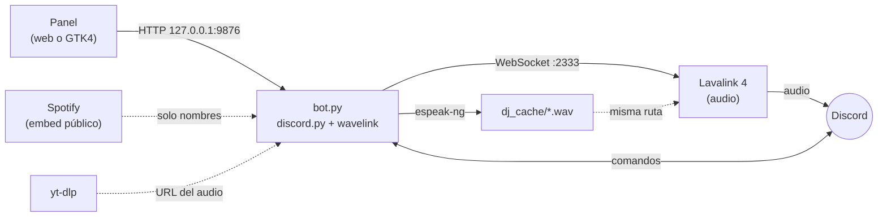

# LavaDJ

Bot de Discord que pone música con un locutor de radio: entre canción y canción
presenta el tema que viene y lee titulares de noticias con voz sintética.

> **Aviso: proyecto vibecoded.** LavaDJ se escribió en su mayor parte con ayuda de
> IA (Claude) y lo revisa su dueño, no un equipo profesional. Funciona, tiene
> tests, pero puede tener aristas. Úsalo bajo tu propio riesgo y no lo trates
> como software de producción.

## Qué hace

- Reproduce música de YouTube en canales de voz, con cola, playlists, búsqueda,
  letras y botones de control en el chat.
- Acepta links de Spotify, pero **solo toma los nombres** de los temas: el audio
  siempre sale de YouTube.
- Un **DJ de radio** mete cortes hablados entre canciones (voz de `espeak-ng` o,
  si la eliges, una voz neuronal de Piper; con filtro de radio vía ffmpeg).
- **Autoplay**: al acabarse la cola sigue solo con temas parecidos.
- **Salta lo que no es música** de los videoclips (intros habladas, sketches, finales)
  con las marcas públicas de SponsorBlock, sin cuenta y enviando solo un prefijo del
  hash del video. Si el servicio no responde, el tema suena entero.
- **Retoma la cola si se reinicia el bot**: la guarda en `estado/colas.json` y, al
  volver, entra al canal donde haya gente y sigue por donde iba (hasta 6 horas
  después). Un `!stop` o la salida por inactividad la borran.
- Dos paneles de control en tu máquina: uno web (cualquier sistema) y uno de
  escritorio GTK4 (solo Linux).
- Funciona en Linux y en Windows.

Son tres procesos separados:



## Requisitos

| | Linux | Windows |
|---|---|---|
| Python 3 con `venv` | 3.11 (la versión con la que se desarrolla) | 3.11 (ídem) |
| Lavalink 4 | contenedor con `podman` | `Lavalink.jar` con Java 21 |
| `yt-dlp` | en `requirements.txt` | en `requirements.txt` (lo instala `setup.ps1`) |
| `espeak-ng` | lo instalas tú | lo instala `setup.ps1` |
| `piper-tts` (opcional: voces neuronales) | en `requirements.txt` | en `requirements.txt` |
| `ffmpeg` | lo instalas tú (recomendado) | lo instala `setup.ps1` |
| `python3-gobject` con GTK4/libadwaita | solo para el panel GTK | no aplica |

`ffmpeg` es opcional: sin él el DJ habla igual, pero sin filtro de radio ni
volumen ajustable. Sin `espeak-ng` el DJ se apaga solo y el resto funciona.

En Linux no hace falta Java: se lo lleva adentro el contenedor de Lavalink (útil
en distros inmutables como Bazzite, donde meter Java en el sistema base es
engorroso).

El plugin de YouTube de Lavalink no lo baja Lavalink por su cuenta: el repositorio
`maven.lavalink.dev` devuelve HTML en lugar de lo que espera y Lavalink no
arrancaría. Lo instala el propio proyecto, desde los releases de GitHub y
verificando su SHA-256: `setup.ps1` en Windows y `start-lavalink.sh` en Linux (con
`curl`, así que sigue sin hacer falta Java en el host). Queda en `lavalink/plugins/`.

## Instalación en Linux

```bash
git clone https://github.com/huffy-it/lavadj.git
cd lavadj

python3 -m venv .venv
.venv/bin/python -m pip install -r requirements.txt

cp .env.example .env                       # y pon adentro tu DISCORD_TOKEN
cp dj_feeds.example.json dj_feeds.json     # opcional: noticias del DJ
```

Instala además, con el gestor de tu distribución, `podman`, `espeak-ng` y
`ffmpeg`.

**yt-dlp** viene en `requirements.txt` y queda en el venv. El bot lo busca en el
PATH, en el venv o en `~/.local/bin/yt-dlp` (o apunta a otro sitio con
`YTDLP_BIN`).

YouTube cambia seguido, así que el bot mantiene yt-dlp al día: lo revisa al
arrancar y cada 24 horas, y lo actualiza si tiene más de 30 días o ningún cliente
de YouTube consigue audio. Para actualizarlo tú, pon `YTDLP_AUTOACTUALIZAR=false`
en el `.env`: el bot solo avisa en el log y en los paneles.

Para arrancar (la primera vez, `start-lavalink.sh` baja el plugin de YouTube a
`lavalink/plugins/` y lo monta en el contenedor de solo lectura):

```bash
scripts/lavalink/start-lavalink.sh         # start | stop | status | logs | run
.venv/bin/python bot.py
```

### Panel de escritorio (opcional)

El panel GTK4 corre con el **python del sistema**, no con el del venv (GTK4 y
libadwaita vienen de `python3-gobject` y no se instalan en el venv). Instala ese
paquete con tu gestor y crea el acceso directo:

```bash
scripts/instalar-acceso-directo.sh         # lo deja en el escritorio y en el menú
python3 scripts/lavadj-panel.py            # o lánzalo directamente
```

El botón **Salir al aire** levanta Lavalink si está abajo y luego el bot.

## Instalación en Windows

Necesitas Python 3 (se desarrolla con 3.11) y `winget` (viene con Windows 11). Desde la raíz del
proyecto, en PowerShell:

```powershell
powershell -ExecutionPolicy Bypass -File scripts\windows\setup.ps1   # una sola vez
```

`setup.ps1` crea el venv, instala las dependencias (`yt-dlp` incluido), instala por winget
Java 21 (Temurin), ffmpeg y eSpeak NG, descarga `Lavalink.jar` y el plugin de
YouTube a `lavalink\` y crea `.env` y `dj_feeds.json` a partir de los ejemplos.
Si winget instaló algo, abre una terminal nueva para que tome el PATH.

Edita `.env`, pon tu `DISCORD_TOKEN` y arranca:

```powershell
scripts\windows\start.ps1                  # levanta Lavalink, abre el panel web y corre el bot
scripts\windows\lavalink.ps1 stop          # baja Lavalink al terminar (start | stop | status | run)
scripts\windows\crear-acceso-directo.ps1   # acceso directo en el escritorio
```

`start.ps1` deja el bot corriendo en esa ventana, con el log a la vista. Ctrl+C o
cerrarla apaga el bot; Lavalink queda arriba hasta que lo bajes. El tope de
memoria de Lavalink se ajusta con `LAVALINK_HEAP` (por defecto 384m en Linux y
768m en Windows).

## Configuración

Copia `.env.example` a `.env`. Lo único obligatorio es `DISCORD_TOKEN`; el resto
tiene valores por defecto en `core/config.py`. **Nunca subas tu `.env`** (ya está
en `.gitignore`).

| Variable | Por defecto | Para qué |
|---|---|---|
| `DISCORD_TOKEN` | — | Token del bot. Obligatoria |
| `PREFIX` | `!` | Prefijo de los comandos |
| `LAVALINK_URI` / `LAVALINK_PASSWORD` | `http://127.0.0.1:2333`, `youshallnotpass` | El nodo de audio |
| `API_PORT` | `9876` | Puerto de la API y del panel web |
| `SERVIDORES_PERMITIDOS` | vacía | IDs de los servidores autorizados, separados por comas o espacios. Vacía = sin restricción |
| `QUEUE_LIMIT` | `500` | Tope duro de la cola |
| `PLAYLIST_LIMIT` | `100` | Cuántos temas se toman de una playlist de una vez |
| `AUTOPLAY_DEFAULT` | `true` | Autoplay al vaciarse la cola |
| `INACTIVE_CHANNEL_TOKENS` | `3` | Canciones seguidas sin humanos en el canal antes de cortar |
| `IDLE_TIMEOUT` | `300` | Segundos sin música antes de irse del canal |
| `DJ_VOLUME` | `100` | Volumen inicial de la voz del DJ (0-200) |
| `DJ_GUIONISTA` | `frases` | Quién escribe lo que dice el DJ: `frases`, `claude` u `ollama` (ver [Guionista del DJ](#guionista-del-dj)) |
| `DJ_GUIONISTA_MODELO` | `claude-opus-5-5` | Modelo de Claude del guionista |
| `ANTHROPIC_API_KEY` | — | Credencial de la API de Anthropic, solo con `DJ_GUIONISTA=claude` |
| `OLLAMA_URL` / `OLLAMA_MODELO` | `http://127.0.0.1:11434`, `llama3.2:3b` | El Ollama local y su modelo, solo con `DJ_GUIONISTA=ollama` |
| `YTDLP_BIN` | autodetectado | Ruta a `yt-dlp` |
| `YTDLP_PLAYER_CLIENT` | `android` | Cliente de YouTube que usa yt-dlp |
| `YTDLP_CLIENTES` | `android,android_vr,ios,mweb,web,tv_simply,web_embedded` | Clientes que el bot prueba, en ese orden, cuando el actual deja de dar audio |
| `YTDLP_AUTOACTUALIZAR` | `true` | Actualizar yt-dlp solo cuando está viejo o ningún cliente suena; `false` para hacerlo tú |
| `YTDLP_TIMEOUT` | `30` | Segundos que se le aguantan a yt-dlp por canción |
| `SPONSORBLOCK` | `true` | Saltar las partes de un videoclip que no son la canción, según SponsorBlock |
| `SPONSORBLOCK_CATEGORIAS` | `music_offtopic` | Categorías de SponsorBlock que se saltan, separadas por comas |
| `SILENCIO_PARA_MUDO` | `300` | Segundos al aire, con cola y sin sonar nada, para dar el bot por mudo |

Si cambias la contraseña de Lavalink, cámbiala en `LAVALINK_PASSWORD` y también
en `scripts/lavalink/application.yml`. La contraseña por defecto es pública, pero
Lavalink solo escucha en `127.0.0.1` (en Linux lo publica así el contenedor; en
Windows lo fuerza `lavalink.ps1`).

### Crear el bot e invitarlo

1. En el [Portal de desarrolladores de Discord](https://discord.com/developers/applications)
   crea una aplicación, añade un **Bot** y copia su token a `DISCORD_TOKEN`.
2. En la pestaña **Bot**, activa el intent privilegiado **Message Content
   Intent**. Sin él el bot no puede leer los comandos con prefijo.
3. Genera la invitación en **OAuth2 > URL Generator** con el scope `bot` y estos
   permisos: ver canales, enviar mensajes, insertar enlaces, leer el historial,
   añadir reacciones (`!search` las usa), conectar y hablar.
4. Abre la URL e invita el bot a tu servidor.

El bot no usa ningún otro intent privilegiado (solo los intents por defecto más
el contenido de mensajes).

**Para que solo funcione en tus servidores**, pon sus IDs en
`SERVIDORES_PERMITIDOS` (activa el modo desarrollador de Discord y usa *Copiar ID
del servidor*). Con la lista llena, el bot se va de cualquier servidor nuevo que
no esté en ella y ignora los comandos en los demás; a los servidores donde ya
estaba no los abandona, solo avisa en el log para que lo resuelvas tú. Con la
lista vacía, el bot acepta cualquier servidor. Desactiva además **Public Bot** en
la pestaña **Bot** del portal: así nadie más puede invitarlo con el ID de tu
aplicación. Si el portal no te deja apagarlo, primero pon **Install Link** en
*None* en la pestaña **Installation**: una aplicación privada no puede tener
enlace de instalación.

## Comandos de Discord

El prefijo por defecto es `!` (se cambia con `PREFIX`). `!help` lista todos.

| Comando | Alias | Qué hace |
|---|---|---|
| `!play <tema o URL>` | `!p` | Reproduce o encola un tema, una URL, una playlist o un link de Spotify |
| `!playnext <tema o URL>` | `!pn`, `!next` | Lo mete al principio de la cola |
| `!search <tema>` | `!buscar` | Muestra 5 opciones y se elige con una reacción |
| `!autoplay [on\|off]` | `!ap` | Sin argumento muestra el estado; al vaciarse la cola sigue solo |
| `!pause` | | Pausa |
| `!resume` | `!r` | Reanuda |
| `!skip` | `!s` | Salta a la siguiente |
| `!stop` | | Para todo, vacía la cola y sale del canal |
| `!queue` | `!q` | Muestra la cola |
| `!nowplaying` | `!np` | Qué está sonando |
| `!panel` | | Vuelve a publicar el panel de botones |
| `!loop` | `!l` | Activa o desactiva la repetición de la canción actual |
| `!shuffle` | | Mezcla la cola |
| `!volume <0-100>` | `!vol` | Ajusta el volumen |
| `!remove <posición>` | `!rm` | Saca de la cola la canción en esa posición |
| `!lyrics [artista - canción]` | `!ly` | Letra de la canción actual, o de la que indiques |
| `!dj` | | El DJ habla en el próximo corte |
| `!dj on\|off` | | Enciende o apaga el DJ |
| `!dj vol [0-200]` | | Muestra o ajusta el volumen de la voz del DJ (0 = mudo) |
| `!refresh` | | Vence los titulares del DJ; se rebajan en el próximo corte |

Los comandos de música no funcionan por mensaje directo. Pausa, reanudar, saltar,
parar, loop, shuffle, volumen y quitar exigen estar en el mismo canal de voz que
el bot, igual que los botones del panel del chat.

**Spotify.** Acepta temas, álbumes y playlists (también `spotify:...`). De cada
tema se toma "Artista - Título" y se busca en YouTube. Los nombres salen del
reproductor embebible público, así que no hace falta registrar una app ni
guardar credenciales. A cambio, una playlist entrega unos 50 temas como máximo y
solo funcionan las listas públicas.

## Paneles

Ambos son clientes HTTP de la API del bot; ninguno comparte proceso con él.

**Panel web.** Con el bot en marcha, abre <http://127.0.0.1:9876/> (el puerto es
`API_PORT`). Muestra el estado del bot, de Lavalink y de yt-dlp, qué suena en
cada servidor, el volumen y la voz del DJ (se elige entre las de Piper), los titulares pendientes, el log
reciente y un botón para apagar el bot. Funciona en cualquier sistema.

**Panel de escritorio GTK4 (solo Linux).** `scripts/lavadj-panel.py`. Enciende y
corta el bot (y levanta Lavalink si hace falta), indica si hay audio, tiene el
fader **VOZ DJ**, el botón de refrescar noticias, el log en vivo, los titulares
con marca en los ya leídos y tema claro u oscuro. Guarda sus ajustes en
`~/.config/lavadj/panel.json`.

**Seguridad.** La API escucha **solo en `127.0.0.1`** y no tiene autenticación.
Nada de fuera de tu máquina llega hasta ella; no la expongas a la red sin añadirle
una clave antes. Para que ninguna página web que abras en el navegador pueda
apagar el bot o leer su estado, la API rechaza (403) las peticiones con un `Host`
que no sea `127.0.0.1`, `localhost` o `[::1]` con su puerto, y los POST cuyo
`Origin` sea otro.

| Endpoint | Método | Qué hace |
|---|---|---|
| `/` | GET | El panel web |
| `/api/status` | GET | Estado del bot, Lavalink, voz, salud de la transmisión y yt-dlp |
| `/api/log` | GET | Últimas líneas de `bot.log` (`?lineas=1-500`) |
| `/api/headlines` | GET | Titulares que el DJ tiene en cola |
| `/api/dj_volume` | GET/POST | Lee o fija el volumen del DJ (`?valor=0-200`) |
| `/api/voces` | GET | Catálogo de voces con su estado, la voz en uso y el filtro de radio |
| `/api/voces/muestra` | GET | Frase de muestra en `audio/wav` (`?voz=<id>`) |
| `/api/voz` | POST | Elige la voz del DJ, solo una instalada (`?voz=<id>`) |
| `/api/voz/filtro` | POST | Enciende o apaga el filtro de radio (`?activo=1\|0`) |
| `/api/voces/descargar` | POST | Baja una voz en segundo plano (`?voz=<id>`) |
| `/api/voces/borrar` | POST | Borra una voz instalada que no esté en uso (`?voz=<id>`) |
| `/api/guionista` | GET/POST | Guionista en uso, cuáles están disponibles y su modelo; con POST lo cambia y guarda la elección (`?nombre=frases\|claude\|ollama`) |
| `/api/refresh_news` | POST | Rebaja los titulares ahora mismo |
| `/api/stop` | POST | Cierre limpio del bot |

## DJ de radio

Entre canciones, el DJ presenta el tema que viene, lee un titular de las noticias
o suelta una frase del banco (`dj_phrases.json`, editable). La voz la sintetiza
`espeak-ng`, ffmpeg le da sonido de emisora y el `.wav` queda en `dj_cache/`
(que se limpia al arrancar). El clip se prepara mientras suena la canción
anterior, así que no corta la música.

Las noticias salen de feeds RSS listados en `dj_feeds.json`, que no se versiona.
Se crea a partir del ejemplo y se edita a gusto; se lee al arrancar el bot:

```bash
cp dj_feeds.example.json dj_feeds.json
```

```json
{ "feeds": ["https://feeds.bbci.co.uk/mundo/rss.xml", "https://rss.dw.com/rdf/rss-sp-all"] }
```

Sin `dj_feeds.json` el DJ funciona igual, solo que sin noticias. Los titulares
viven en memoria (se descartan al reiniciar). `!refresh`, o el botón de los
paneles, los renueva al momento.

`dj_cache/` se monta dentro del contenedor de Lavalink con la **misma ruta
absoluta** que usa el bot. Si mueves el proyecto de carpeta, reinicia Lavalink.

### Voz del DJ

Por defecto habla `espeak-ng`. Con [Piper](https://github.com/OHF-Voice/piper1-gpl)
puedes darle una voz neuronal en español (Argentina, España o México), mucho más
natural. Se elige en el panel web, sección **Voz del DJ** (en el panel GTK, el botón
**Voces…** lo abre):

- **▶ Escuchar** sintetiza una frase con esa voz y el filtro actual.
- **Descargar** baja la voz a `voces/` (de 28 a 114 MB). Solo se baja lo que está en
  el catálogo de `core/voces.py` (sale de `rhasspy/piper-voices`) y se verifica su md5.
- **Usar** la activa desde el próximo corte; **Borrar** libera el espacio de una que
  no uses.
- **Filtro de radio**, encendido por defecto, vale para cualquier voz: apágalo si
  prefieres la voz limpia.

La elección se guarda en `estado/ajustes.json`. Si Piper falla o no está instalado, el
DJ sigue con `espeak-ng` y lo avisa en el log. `piper-tts` es GPL-3.0 y LavaDJ es MIT:
por eso corre siempre como proceso aparte (`python -m piper`) y el código no lo importa.

### Guionista del DJ

Por defecto el DJ presenta las canciones con frases fijas. Con un guionista, un
modelo de lenguaje escribe cada presentación a partir del título, el artista, quién
pidió el tema, la hora y, a veces, un titular de noticias. Si el modelo no responde
o se niega, ese corte sale con las frases de siempre. Se elige con `DJ_GUIONISTA`
en el `.env`:

- `frases` (por defecto): sin guionista y sin costo.
- `claude`: usa la API de Anthropic y **cobra por uso**, una llamada por
  presentación. Pon `ANTHROPIC_API_KEY` en el `.env` (o inicia sesión con
  `ant auth login`). El modelo por defecto es `claude-opus-5-5`;
  `DJ_GUIONISTA_MODELO=claude-haiku-5-5` es bastante más barato.
- `ollama`: usa un modelo local, gratis. Instala [Ollama](https://ollama.com), baja
  el modelo (`ollama pull llama3.2:3b`) y déjalo corriendo; `OLLAMA_URL` y
  `OLLAMA_MODELO` lo ajustan. Si el modelo tarda en cargarse, esa presentación sale
  con las frases.

También se elige en caliente desde el panel web (sección **Guionista del DJ**): esa
elección se guarda en `estado/ajustes.json` y gana sobre el `.env`.

## Cuando YouTube deja de sonar

El audio de YouTube lo resuelve **yt-dlp** (`core/resolver.py`) y Lavalink solo
reproduce la URL; el plugin de YouTube de Lavalink queda como respaldo. Si
`!play` encuentra el tema pero no suena, casi siempre es yt-dlp desactualizado o
un cliente de YouTube que YouTube cerró. El bot lo intenta arreglar solo: tras
varios fallos seguidos prueba los clientes de `YTDLP_CLIENTES` y se pasa al primero
que suena, y si ninguno sirve actualiza yt-dlp. Todo queda en `logs/bot.log`. El
cambio de cliente dura hasta reiniciar: para fijarlo, ponlo en `YTDLP_PLAYER_CLIENT`
del `.env`. Si aun así no suena:

1. Actualiza yt-dlp.
2. Prueba otro cliente y ponlo en `YTDLP_PLAYER_CLIENT` dentro de `.env`
   (`android_vr`, `ios`, `mweb`, `web`...).
3. Mira `logs/bot.log` y, en Linux, `podman logs lavadj-lavalink`.
4. Comprueba que suena con `scripts/probar-que-suena.py` (ver [Desarrollo](#desarrollo)).

El diagnóstico completo, con los comandos para separar qué capa falla, está en
[AGENTS.md](AGENTS.md). El proyecto no usa credenciales ni cookies de YouTube, y
eso es una decisión de diseño.

## Desarrollo

```bash
# Linux
.venv/bin/python -m pip install -r requirements-dev.txt
.venv/bin/python -m pytest
```

```powershell
# Windows
.\.venv\Scripts\python.exe -m pip install -r requirements-dev.txt
.\.venv\Scripts\python.exe -m pytest
```

Los tests son async (`asyncio_mode = auto`) y corren en unos segundos, sin red. Usa
siempre el python del venv: con el del sistema no se colectan.

Para comprobar que el audio de YouTube suena de verdad (no solo que el código
funcione) hay dos pruebas aparte, que **no** corren con `pytest` a secas y que se
ejecutan en tu máquina, no en CI, porque YouTube bloquea las IP de centros de datos:

```powershell
# Windows (en Linux: .venv/bin/python)
.\.venv\Scripts\python.exe -m pytest -m integracion          # Lavalink y yt-dlp reales, sin entrar a voz
.\.venv\Scripts\python.exe scripts\probar-que-suena.py       # entra a un canal de voz y toca varias pistas
```

Las dos necesitan Lavalink arriba, y el script además necesita el bot apagado (o
`--cortar-bot`). Los detalles están en [AGENTS.md](AGENTS.md).

Antes de tocar código lee [AGENTS.md](AGENTS.md): explica la arquitectura, las
reglas del proyecto (el audio siempre sale de Lavalink, el panel solo habla por
HTTP, `.env` nunca se commitea) y los diagnósticos de audio. Documentación,
comentarios y commits van en español neutro.

## Licencia

[MIT](LICENSE).
